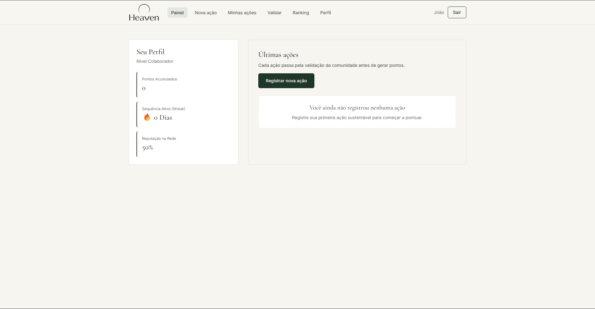
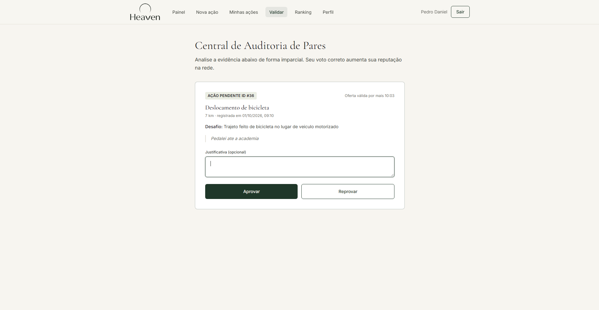
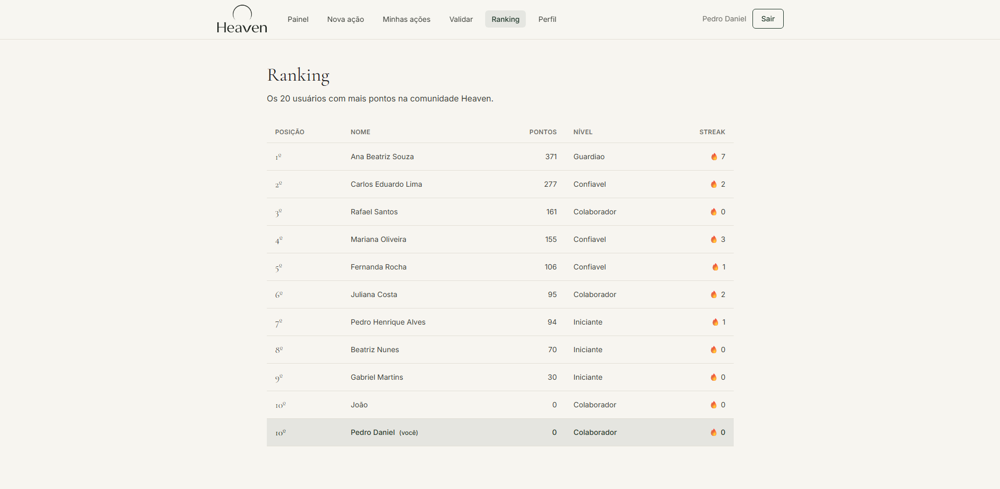

# Heaven

Plataforma de gamificação de ações sustentáveis. Este repositório contém o front-end do Heaven, desenvolvido na Sprint 04 da disciplina Front-End Design Engineering (FIAP, turma 1TDSPW).

## Título e Descrição

**Problema.** Iniciativas de créditos de carbono e de recompensas ecológicas costumam depender de auditorias centralizadas, caras e lentas. Por isso, pequenas ações do dia a dia, como usar transporte público, reciclar ou economizar energia, dificilmente são validadas e recompensadas em larga escala.

**Proposta.** No Heaven, o usuário registra ações sustentáveis e outros membros da comunidade as validam, de forma distribuída e anônima. Ações aprovadas geram pontos e mantêm ativa a sequência de dias (streak), e quem valida corretamente ganha reputação e mais peso de voto.

### O que esta entrega implementa

Nesta sprint o front deixou de usar dados estáticos: é uma aplicação React de página única (SPA) que consome a **API Java do Heaven** (Spring Boot + Oracle), com cadastro, login, ações, validação, ranking e perfil. Todas as telas de dados tratam os estados de carregamento, erro e vazio, e a decisão sobre cada erro usa o código devolvido pela API.

- **Cadastro e login:** criação de conta (senha com no mínimo 8 caracteres) e entrada com sessão guardada no navegador; as rotas de `/app` só abrem com login.
- **Painel:** pontos, sequência (streak), reputação e nível reais, e as últimas ações do usuário.
- **Nova ação:** tipos vindos da API, quantidade na unidade do tipo e evidência em texto.
- **Detalhe do tipo de ação:** categoria, unidade, dificuldade e o desafio do tipo.
- **Minhas ações:** histórico com o status de cada ação e cancelamento das pendentes, com confirmação.
- **Validar:** sorteio de uma ação anônima de outro usuário, voto de aprovação ou reprovação com justificativa opcional e tempo restante da oferta.
- **Ranking:** os 20 usuários com mais pontos, em tabela no tablet e desktop e em cartões no celular.
- **Perfil:** edição de nome, e-mail e senha, e desativação da conta.
- **Páginas públicas:** Home, Solução (atalhos para as telas reais), Sobre, Integrantes, FAQ e Contato.
- **Responsividade e acessibilidade:** layouts para mobile, tablet e desktop, link para pular ao conteúdo, menu mobile que fecha com Esc e mensagens anunciadas por leitores de tela.

### Rotas

| Rota | Acesso | Conteúdo |
| --- | --- | --- |
| `/` | Pública | Home |
| `/solucao` | Pública | Solução, com atalhos para as telas da área logada |
| `/sobre` | Pública | Sobre |
| `/integrantes` | Pública | Integrantes |
| `/faq` | Pública | FAQ |
| `/contato` | Pública | Contato |
| `/cadastro` | Pública | Cadastro |
| `/login` | Pública | Login |
| `/app` | Login | Painel |
| `/app/acoes/nova` | Login | Nova ação |
| `/app/acoes/:id` | Login | Detalhe de um tipo de ação (id numérico) |
| `/app/minhas-acoes` | Login | Minhas ações |
| `/app/validar` | Login | Validar ações de outros usuários |
| `/app/ranking` | Login | Ranking |
| `/app/perfil` | Login | Perfil |
| `*` | Pública | Qualquer caminho inexistente: página "Página não encontrada" (404) |

### Páginas da solução

| Tela | Rota | O que faz | Endpoints da API |
| --- | --- | --- | --- |
| Solução | `/solucao` | Apresenta a solução e leva às telas da área logada por seis atalhos; para quem não entrou, mostra os botões de cadastro e login | Nenhum |
| Painel | `/app` | Mostra pontos, sequência (streak), reputação e nível do usuário e as 5 últimas ações | `GET /api/usuarios/me`, `GET /api/acoes/minhas` |
| Nova ação | `/app/acoes/nova` | Registra uma ação sustentável com tipo, quantidade e evidência | `GET /api/tipos-acao`, `POST /api/acoes` |
| Minhas ações | `/app/minhas-acoes` | Lista o histórico com o status de cada ação e cancela as pendentes, com confirmação | `GET /api/acoes/minhas`, `DELETE /api/acoes/{id}` |
| Validar | `/app/validar` | Sorteia uma ação anônima de outro usuário e registra o voto de aprovação ou reprovação | `POST /api/validacoes/sorteio`, `POST /api/validacoes` |
| Ranking | `/app/ranking` | Mostra os 20 usuários com mais pontos e destaca o próprio usuário | `GET /api/ranking?limite=20`, `GET /api/usuarios/me` |
| Perfil | `/app/perfil` | Mostra os dados da conta, edita nome, e-mail e senha e desativa a conta | `GET /api/usuarios/me`, `PUT /api/usuarios/me`, `DELETE /api/usuarios/me` |
| Detalhe do tipo de ação | `/app/acoes/:id` | Mostra categoria, unidade, dificuldade e desafio de um tipo de ação; id inexistente exibe "Tipo de ação não encontrado" | `GET /api/tipos-acao/{id}` |

## Tecnologias utilizadas

Versões principais declaradas no `package.json`:

| Tecnologia | Versão | Uso no projeto |
| --- | --- | --- |
| React | 19 | Interface e componentização |
| TypeScript | 6 | Linguagem do projeto (TSX), com tipagem de componentes, props e dados |
| Vite | 8 | Servidor de desenvolvimento e build |
| Tailwind CSS | 4 | Estilização da interface, via plugin `@tailwindcss/vite` |
| React Router DOM | 7 | Rotas e navegação SPA |
| React Hook Form | 7 | Validação de formulários |
| oxlint | 1 | Análise estática do código |
| Fetch nativo | — | Chamadas à API, sem Axios nem outra biblioteca de requisição |
| Git e GitHub | — | Versionamento |

O projeto também usa as fontes Cormorant Garamond e Inter, carregadas do Google Fonts, e o Node.js com npm para instalar as dependências e executar os scripts.

## Estrutura de pastas

Visão resumida das pastas principais:

```text
heaven-frontend-2semestre/
├── docs/
│   ├── contrato-api.md    # contrato da API (fonte única)
│   └── telas/             # capturas de tela usadas neste README
├── public/
│   └── favicon.svg
├── src/
│   ├── assets/images/     # logo, composição de marca e fotos dos integrantes
│   ├── components/        # componentes reutilizáveis: Button, Navbar, AppHeader, Footer, EstadoApi, campos de formulário, ícones etc.
│   ├── context/           # AuthContext: sessão, login e logout
│   ├── data/              # dados estáticos das páginas públicas: perguntas do FAQ e integrantes
│   ├── features/          # formulários por domínio: auth (cadastro e login), actions (nova ação) e profile (perfil)
│   ├── hooks/             # useApi (carregando, erro, vazio e sucesso), useAuth e useAposAtraso
│   ├── layouts/           # PublicLayout, AuthLayout e AppLayout
│   ├── pages/
│   │   ├── public/        # Home, Sobre, Integrantes, FAQ, Contato e Solucao
│   │   ├── auth/          # Login e Cadastro
│   │   └── app/           # Painel, Actions (nova ação e detalhe), MinhasAcoes, Validar, Ranking e Perfil
│   ├── routes/            # árvore de rotas (AppRoutes.tsx) e caminhos (routeConfig.ts)
│   ├── services/          # camada de acesso à API: http.ts (fetch) e um arquivo por recurso
│   ├── styles/            # globals.css: Tailwind e tokens do design system
│   ├── types/             # tipos da API (api.ts) e tipos compartilhados
│   ├── utils/             # formatação e mensagens de erro
│   ├── App.tsx
│   └── main.tsx
├── index.html
├── package.json
├── package-lock.json
├── tsconfig.json          # e tsconfig.app.json, tsconfig.node.json
├── vercel.json
├── vite.config.ts
└── .oxlintrc.json
```

## Autores e Créditos

| Foto | Nome | RM | Turma | GitHub | LinkedIn |
| --- | --- | --- | --- | --- | --- |
|  | Arthur de Souza Lopes | 573023 | 1TDSPW | [arthurlopes2007](https://github.com/arthurlopes2007) | [Perfil](https://www.linkedin.com/in/arthur-souza-lopes-037112346/) |
|  | Lucas Bossi Cruz | 572876 | 1TDSPW | [bsscrz](https://github.com/bsscrz) | [Perfil](https://www.linkedin.com/in/lucas-bossi-1a54443a3/) |
|  | Pedro Daniel Melo de Moraes | 569786 | 1TDSPW | [PedroDaniel7](https://github.com/PedroDaniel7) | [Perfil](https://www.linkedin.com/in/pedrodanielmoraes/) |
|  | Rick Nascimento da Costa | 571828 | 1TDSPW | [rcostaa-dev](https://github.com/rcostaa-dev) | [Perfil](https://www.linkedin.com/in/rick-nascimento-b063733b6/) |
|  | Eduardo Oliveira Conde | 573163 | 1TDSPW | [eduardo-oliveira-conde](https://github.com/eduardo-oliveira-conde) | [Perfil](https://www.linkedin.com/in/eduardo-conde-663213348/) |

## Imagens e ícones

### Identidade visual


Composição de marca exibida ao lado do formulário de Cadastro no desktop (`src/assets/images/cadastro-heaven.png`). A logo oficial fica em `src/assets/images/logo-heaven.png`; como o arquivo é branco, o componente `Logo` o usa como máscara para aplicar a cor do texto sobre fundos claros.

### Capturas de tela



Painel do usuário (`/app`).



Validação de uma ação sorteada (`/app/validar`).



Ranking da comunidade (`/app/ranking`).

### Ícones do sistema

Os ícones são SVGs inline definidos em `src/components/icons/index.tsx`, sem biblioteca de ícones.

| Ícone | Onde aparece |
| --- | --- |
| `MenuIcon` e `CloseIcon` | Botão de abrir e fechar o menu mobile |
| `ArrowRightIcon` | Botões e links de ação na Home, no Cadastro, no Dashboard e no detalhe da ação |
| `ChevronDownIcon` | Perguntas do FAQ e campo de seleção do Dashboard |
| `UserIcon`, `MailIcon` e `LockIcon` | Campos de nome, e-mail e senha do Cadastro |
| `EyeIcon` e `EyeOffIcon` | Mostrar e ocultar a senha |
| `MailIcon` e `PhoneIcon` | E-mails e telefones da página Contato |

## Como usar

- **Repositório GitHub do front:** https://github.com/PedroDaniel7/heaven-frontend-2semestre
- **Vídeo no YouTube:** https://youtu.be/LLxT6jbteKs
- **Aplicação na Vercel:** https://heaven-frontend-2semestre.vercel.app
- **API (Render):** https://heaven-java-api.onrender.com — a raiz devolve 404 por design, pois a API responde em `/api/...`; para conferir, abra https://heaven-java-api.onrender.com/api/saude (deve devolver status OK) ou a documentação em https://heaven-java-api.onrender.com/swagger-ui/index.html. O servidor gratuito pode levar cerca de 1 minuto para acordar na primeira chamada.
- **Repositório da API Java:** https://github.com/PedroDaniel7/heaven-java-api

> A API roda em um plano gratuito: depois de um tempo sem uso, a primeira chamada pode levar cerca de 1 minuto para acordar o servidor. O front mostra o aviso "Acordando o servidor, pode levar até 1 minuto".

### Pré-requisitos

- Node.js 20.19+ ou 22.12+ (requisito do Vite 8)
- npm
- Git

### Execução local

```bash
git clone https://github.com/PedroDaniel7/heaven-frontend-2semestre.git
cd heaven-frontend-2semestre
npm install
cp .env.example .env.local
npm run dev
```

Defina em `.env.local` a variável `VITE_API_URL` com a URL base da API, sem barra no final (a API publicada acima ou `http://localhost:8080` para uma API local). O arquivo `.env.local` não é versionado. Depois, abra no navegador o endereço exibido no terminal (por padrão, `http://localhost:5173`).

| Variável | Para que serve | Exemplo |
| --- | --- | --- |
| `VITE_API_URL` | URL base da API, sem barra no final | `http://localhost:8080` |

### Scripts

| Comando | O que faz |
| --- | --- |
| `npm run dev` | Servidor de desenvolvimento |
| `npm run build` | Verifica os tipos e gera a versão de produção em `dist/` |
| `npm run preview` | Serve localmente a versão gerada pelo build |
| `npm run lint` | Analisa o código com o oxlint |
| `npm run typecheck` | Verifica os tipos com o TypeScript |

### Deploy e contrato da API

O deploy é feito na Vercel, com `VITE_API_URL` definida em **Settings > Environment Variables** e o `vercel.json` reescrevendo as rotas para o `index.html` da SPA. Os endpoints, os tipos e os códigos de erro estão em [`docs/contrato-api.md`](docs/contrato-api.md).

## Contato

Para falar com a equipe, escreva para qualquer integrante:

| Integrante | E-mail |
| --- | --- |
| Arthur de Souza Lopes | arthurdesouzalopes635@gmail.com |
| Lucas Bossi Cruz | lucabossicruz@gmail.com |
| Pedro Daniel Melo de Moraes | pedrodaniel.mmoraes@gmail.com |
| Rick Nascimento da Costa | rickgodinhotk7@gmail.com |
| Eduardo Oliveira Conde | edu.conde021@gmail.com |

Os telefones dos integrantes estão na página Contato da aplicação (`/contato`).
